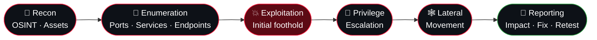

<!-- ═══════════════════════════════════════════════════════════════════
     ملف البروفايل: يجب أن يكون في مستودع باسم  NULL200OK/NULL200OK  (Public)
     Profile README: must live in a public repo named exactly  NULL200OK/NULL200OK
     ═══════════════════════════════════════════════════════════════════ -->

<!-- ───────────────────────── HEADER ───────────────────────── -->
<p align="center">
  
</p>

<p align="center">
  <a href="https://git.io/typing-svg">
    
  </a>
</p>

<p align="center">
  
  
  
</p>

<p align="center">
  
  <a href="https://github.com/NULL200OK?tab=followers"></a>
  <a href="https://github.com/NULL200OK?tab=repositories"></a>
</p>

---

<!-- ───────────────────────── TERMINAL ───────────────────────── -->
## 🩸 `~/whoami`

```console
root@null200ok:~# cat profile.txt

 name        : Nabil Hassan  (aka NULL200OK)
 title       : Cybersecurity Expert · Offensive Security · Software Developer
 specialty   : Red Team ops, web & mobile pentesting, exploit research, custom tooling
 also        : AI-assisted security automation
 languages   : العربية  ·  English
 philosophy  : "If it has an input, it has an attack surface."
 ethics      : scope first, written authorization always, report responsibly

root@null200ok:~# _
```

> **I think like an attacker so defenders don't have to learn the hard way.**
> I map attack surfaces, chain small weaknesses into real impact, and turn the findings into reports that engineering teams can actually act on.

<br>

<!-- ───────────────────────── FOCUS ───────────────────────── -->
## 🎯 `Focus Areas`

<table>
  <tr>
    <td width="50%" valign="top">

### 🌐 Web Application Security
OWASP Top 10 · Auth & session flaws · IDOR / BOLA · SSRF · SQLi / NoSQLi · XSS · deserialization · race conditions · business-logic abuse · API & GraphQL testing

### 📱 Mobile Security
Android reverse engineering · APK static & dynamic analysis · SSL-pinning & root-detection bypass · insecure storage · exported components · deep-link abuse

    </td>
    <td width="50%" valign="top">

### 🏴 Red Team & Post-Exploitation
Recon & OSINT · initial access paths · privilege escalation (Linux / Windows) · Active Directory attack paths · lateral movement · persistence · C2 tradecraft · evasion research

### 🛠 Tooling & Automation
Custom recon pipelines · fuzzers & scanners · exploit PoCs · report generators · AI-assisted triage to cut the noise from raw scan data

    </td>
  </tr>
</table>

<br>

<!-- ───────────────────────── KILL CHAIN ───────────────────────── -->
## ⛓ `Methodology`



<br>

<!-- ───────────────────────── ARSENAL ───────────────────────── -->
## 🧰 `Arsenal`

**Offensive tooling**

<p>
  
  
  
  
  
  
  
  
  
  
</p>

**Languages**

<p>
  
  
  
  
  
  
  
  
</p>

**Platforms & labs**

<p>
  
  
  
  
  
  
  
</p>

<br>

<!-- ───────────────────────── FEATURED ───────────────────────── -->
## 🛡 `Featured Project — Keep Safe (أمان)`

> The same attacker's eye, turned around: an Android defense app I built for **non-technical users**.

| | |
|---|---|
| 🔗 **Link scanner** | Phishing / malicious URL risk scoring before you open it |
| 🛰 **DNS-filter VPN** | Local VPN that blocks malware & adult domains, with forced SafeSearch and bedtime schedules |
| 👨‍👩‍👧 **Family protection** | Protection levels, custom block/allow lists, PIN-guarded settings, weekly report |
| 🔍 **Phone security check** | 0–100 score with one-tap fixes, plus private leaked-password check (k-anonymity) |
| 📩 **Scam detection** | Suspicious SMS, calls and email analysis |

<p>
  
  
  
</p>

<br>

<!-- ───────────────────────── STATS ───────────────────────── -->
## 📊 `Telemetry`

<p align="center">
  <a href="https://github.com/NULL200OK">
    
  </a>
  <a href="https://github.com/NULL200OK">
    
  </a>
</p>

<p align="center">
  
</p>

<p align="center">
  
</p>

<p align="center">
  
</p>

<br>

<!-- ───────────────────────── CONTACT ───────────────────────── -->
## 📡 `Contact`

<p>
  <a href="https://github.com/NULL200OK"></a>
  <!-- أضف روابطك هنا / add your links here — احذف علامات التعليق وعدّل الروابط:
  <a href="mailto:YOUR_EMAIL"></a>
  <a href="https://linkedin.com/in/YOUR_ID"></a>
  <a href="https://x.com/YOUR_ID"></a>
  <a href="https://t.me/YOUR_ID"></a>
  -->
</p>

> 💬 Open to: **authorized pentests · red-team engagements · bug bounty collaboration · security tooling projects**

<br>

<!-- ───────────────────────── DISCLAIMER ───────────────────────── -->
<details>
<summary><b>⚖️ Ethics & disclaimer</b></summary>

<br>

Everything I publish is for **education, research and authorized security testing only**. I only test systems I own or have explicit written permission to assess, I follow responsible-disclosure practice, and I do not support the misuse of any tool or technique shown here. You are responsible for your own actions.

</details>

<p align="center">
  <i>"The only truly secure system is one that is powered off, cast in a block of concrete and sealed in a lead-lined room — and even then I have my doubts."</i><br><sub>— Gene Spafford</sub>
</p>


