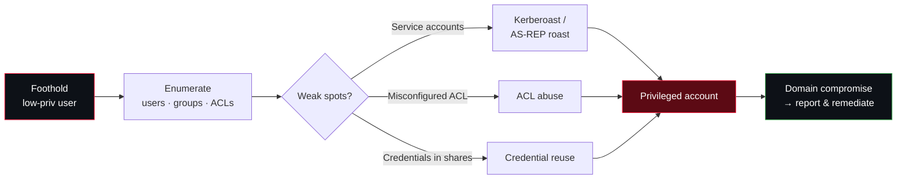
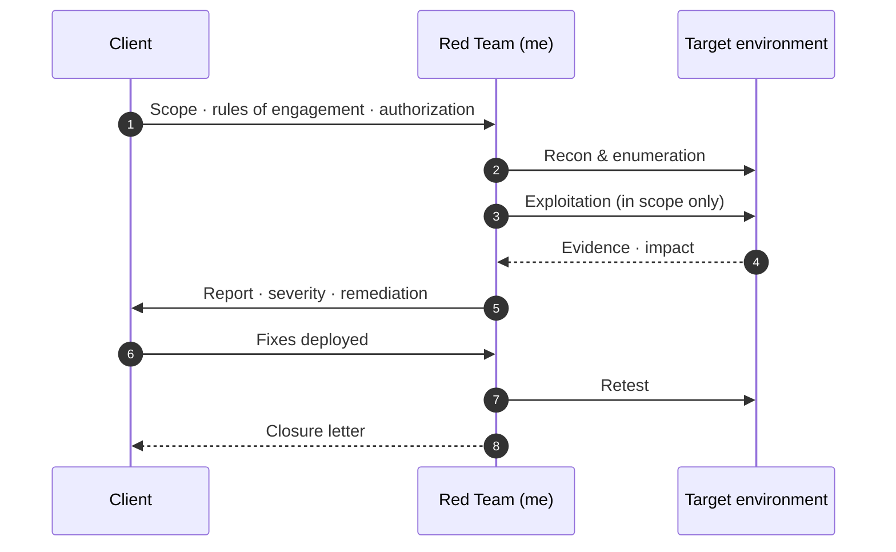

<!-- ═══════════════════════════════════════════════════════════════════
     يجب أن يكون هذا الملف في مستودع عام باسم  NULL200OK/NULL200OK
     مع مجلد assets/ و .github/workflows/ بجانبه.
     Must live in a public repo named exactly  NULL200OK/NULL200OK
     together with the assets/ and .github/workflows/ folders.
     ═══════════════════════════════════════════════════════════════════ -->

<!-- ───────────────────────── HEADER ───────────────────────── -->
<p align="center">
  
</p>

<p align="center">
  <a href="https://git.io/typing-svg">
    
  </a>
</p>

<!-- ───────────────────────── NAV ───────────────────────── -->
<p align="center">
  <a href="#whoami"></a>
  <a href="#recon"></a>
  <a href="#missions"></a>
  <a href="#arsenal"></a>
  <a href="#project"></a>
  <a href="#telemetry"></a>
  <a href="#ctf"></a>
  <a href="#contact"></a>
</p>

<p align="center">
  
  
  
  
  <a href="https://github.com/NULL200OK?tab=followers"></a>
</p>

<p align="center"></p>

<!-- ───────────────────────── WHOAMI ───────────────────────── -->
<h2 id="whoami">🩸 ~/whoami</h2>

<p align="center"></p>

> **I think like an attacker so defenders don't have to learn the hard way.**
> I map attack surfaces, chain small weaknesses into real impact, and turn the findings into reports that engineering teams can actually act on.

```yaml
name:        Nabil Hassan  (NULL200OK)
title:       Cybersecurity Expert · Offensive Security · Software Developer
specialty:   Red Team ops · web & mobile pentesting · exploit research · custom tooling
also:        AI-assisted security automation
languages:   [ العربية, English ]
philosophy:  "If it has an input, it has an attack surface."
ethics:      scope first · written authorization always · responsible disclosure
```

<p align="center"></p>

<!-- ───────────────────────── RECON ───────────────────────── -->
<h2 id="recon">📡 Attack Surface — live radar</h2>

<table>
  <tr>
    <td width="46%" align="center" valign="middle">
      
    </td>
    <td width="54%" valign="top">

**🌐 WEB** — OWASP Top 10, auth & session flaws, IDOR / BOLA, SSRF, injection, business-logic abuse

**🔌 API** — REST / GraphQL, broken object-level auth, mass assignment, rate-limit bypass

**📱 MOBILE** — Android RE, APK static & dynamic analysis, SSL-pinning & root-detection bypass

**🏰 AD** — attack-path mapping, Kerberos abuse, ACL misconfigurations, lateral movement

**☁️ CLOUD** — IAM misconfigurations, exposed storage, metadata-service abuse

**🕸 NETWORK** — service enumeration, protocol weaknesses, segmentation & pivoting

    </td>
  </tr>
</table>

<h3>⛓ Engagement flow</h3>

<p align="center"></p>

<p align="center"></p>

<!-- ───────────────────────── MISSIONS ───────────────────────── -->
<h2 id="missions">🗂 Missions — click to expand</h2>

<details>
<summary><b>🌐 &nbsp;Web &amp; API pentest checklist</b> &nbsp;<sub>(click)</sub></summary>

<br>

| Phase | What I look at |
|---|---|
| **Recon** | subdomains, tech stack, JS files, hidden endpoints, exposed `.git` / backups |
| **Auth** | weak resets, session fixation, JWT misuse, OAuth redirect flaws, 2FA bypass |
| **Access control** | IDOR / BOLA, forced browsing, role & tenant confusion |
| **Input** | SQLi / NoSQLi, XSS, SSTI, XXE, command injection, SSRF, file upload |
| **Logic** | race conditions, price / quantity tampering, workflow skipping |
| **Reporting** | reproducible PoC · impact in business terms · concrete fix · retest |

</details>

<details>
<summary><b>📱 &nbsp;Android security checklist</b> &nbsp;<sub>(click)</sub></summary>

<br>

- [x] Decompile & review manifest: exported components, debuggable / backup flags
- [x] Insecure storage: SharedPreferences, SQLite, logs, clipboard
- [x] Network: cleartext traffic, weak TLS, certificate-pinning strength
- [x] Deep links, intents & WebView misconfigurations
- [x] Hard-coded secrets, API keys, tokens
- [x] Runtime tampering resistance: root / emulator / Frida detection
- [x] Backend API behind the app (the real target most of the time)

</details>

<details>
<summary><b>🏰 &nbsp;Active Directory attack path</b> &nbsp;<sub>(click)</sub></summary>

<br>



</details>

<details>
<summary><b>🧪 &nbsp;Recon cheat-sheet (lab / authorized targets only)</b> &nbsp;<sub>(click)</sub></summary>

<br>

```bash
# service & version discovery
nmap -sC -sV -T4 -oA scan lab.target.local

# content discovery
ffuf -u https://lab.target.local/FUZZ -w common.txt -mc 200,204,301,302,403

# template-based vulnerability checks
nuclei -u https://lab.target.local -severity medium,high,critical

# quick HTTP probing of a host list
cat hosts.txt | httpx -status-code -title -tech-detect
```

> Run these **only** against systems you own or are explicitly authorized to test.

</details>

<details>
<summary><b>🔁 &nbsp;Engagement lifecycle</b> &nbsp;<sub>(click)</sub></summary>

<br>



</details>

<p align="center"></p>

<!-- ───────────────────────── ARSENAL ───────────────────────── -->
<h2 id="arsenal">🧰 Arsenal</h2>

<details open>
<summary><b>Offensive tooling</b></summary>

<p>
  
  
  
  
  
  
  
  
  
  
</p>
</details>

<details open>
<summary><b>Languages</b></summary>

<p>
  
  
  
  
  
  
  
  
</p>
</details>

<details open>
<summary><b>Platforms &amp; labs</b></summary>

<p>
  
  
  
  
  
  
  
</p>
</details>

<p align="center"></p>

<!-- ───────────────────────── PROJECT ───────────────────────── -->
<h2 id="project">🛡 Featured project — Keep Safe (أمان)</h2>

> The same attacker's eye, turned around: an Android defense app I built for **non-technical users**.

| | |
|---|---|
| 🔗 **Link scanner** | Phishing / malicious URL risk scoring before you open it, also via the system Share menu |
| 🛰 **DNS-filter VPN** | Local VPN that blocks malware & adult domains, with forced SafeSearch and bedtime schedules |
| 👨‍👩‍👧 **Family protection** | Protection levels, custom block / allow lists, PIN-guarded settings, weekly report |
| 🔍 **Phone security check** | 0–100 score with one-tap fixes, plus a private leaked-password check (k-anonymity) |
| 📩 **Scam detection** | Suspicious SMS, calls and email analysis |

<p>
  
  
  
</p>

<p align="center"></p>

<!-- ───────────────────────── TELEMETRY ───────────────────────── -->
<h2 id="telemetry">📊 Telemetry</h2>

<p align="center">
  <a href="https://github.com/NULL200OK">
    
  </a>
  <a href="https://github.com/NULL200OK">
    
  </a>
</p>

<p align="center">
  
</p>

<p align="center">
  
</p>

<p align="center">
  
</p>

<!-- الأفعى تُولَّد تلقائيًا بعد تشغيل workflow (انظر .github/workflows/snake.yml) -->
<p align="center">
  <picture>
    <source media="(prefers-color-scheme: dark)" srcset="https://raw.githubusercontent.com/NULL200OK/NULL200OK/output/github-snake-dark.svg"/>
    <source media="(prefers-color-scheme: light)" srcset="https://raw.githubusercontent.com/NULL200OK/NULL200OK/output/github-snake.svg"/>
    
  </picture>
</p>

<p align="center"></p>

<!-- ───────────────────────── CTF ───────────────────────── -->
<h2 id="ctf">🚩 Capture the flag — mini challenge</h2>

Found something odd? Decode it. Send me the flag if you solve it. 😉

<details>
<summary><b>🔒 Classified payload</b> &nbsp;<sub>(click to reveal)</sub></summary>

<br>

```text
U1lOVHthaHl5MjAwYnhfanJ5cGJ6cmZfbGJofQ==
```

<details>
<summary><i>Need a hint?</i></summary>

<br>

`Base64` → then a classic Caesar-style rotation that every beginner learns first. 🔁

</details>

</details>

<br>

<!-- ───────────────────────── QUOTE ───────────────────────── -->
<p align="center">
  <a href="https://git.io/typing-svg">
    
  </a>
</p>

<!-- ───────────────────────── CONTACT ───────────────────────── -->
<h2 id="contact">📡 Contact</h2>

<p>
  <a href="https://github.com/NULL200OK"></a>
  <!-- أضف روابطك هنا / add your links here — احذف علامات التعليق وعدّل الروابط:
  <a href="mailto:YOUR_EMAIL"></a>
  <a href="https://linkedin.com/in/YOUR_ID"></a>
  <a href="https://x.com/YOUR_ID"></a>
  <a href="https://t.me/YOUR_ID"></a>
  -->
</p>

> 💬 Open to: **authorized pentests · red-team engagements · bug bounty collaboration · security tooling projects**

<details>
<summary><b>⚖️ Ethics &amp; disclaimer</b></summary>

<br>

Everything I publish is for **education, research and authorized security testing only**. I only test systems I own or have explicit written permission to assess, I follow responsible-disclosure practice, and I do not support the misuse of any tool or technique shown here. You are responsible for your own actions.

</details>

<p align="center">
  <i>"The only truly secure system is one that is powered off, cast in a block of concrete and sealed in a lead-lined room — and even then I have my doubts."</i><br><sub>— Gene Spafford</sub>
</p>


